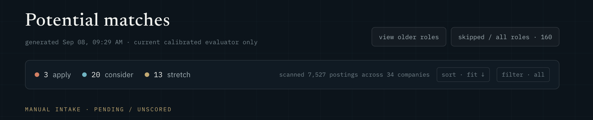
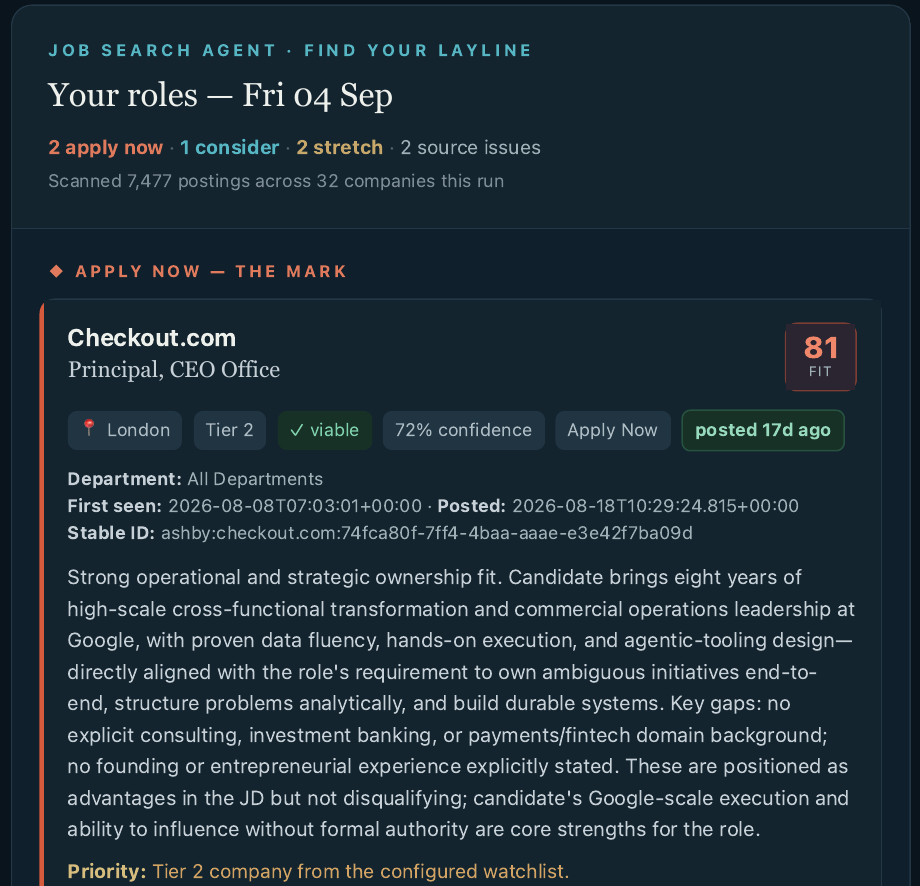
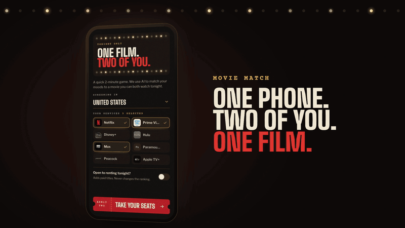
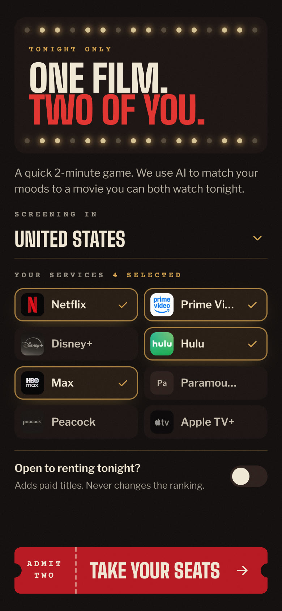
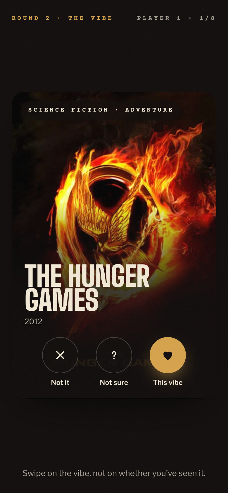
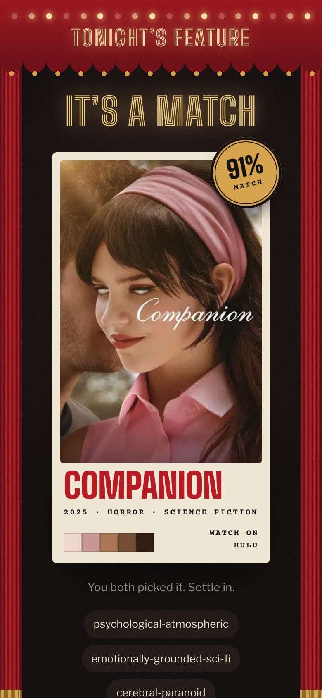
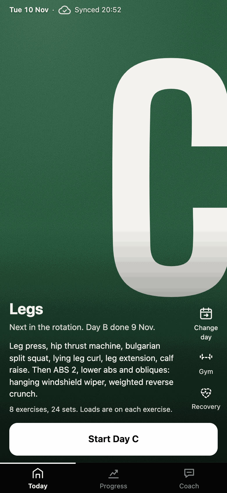
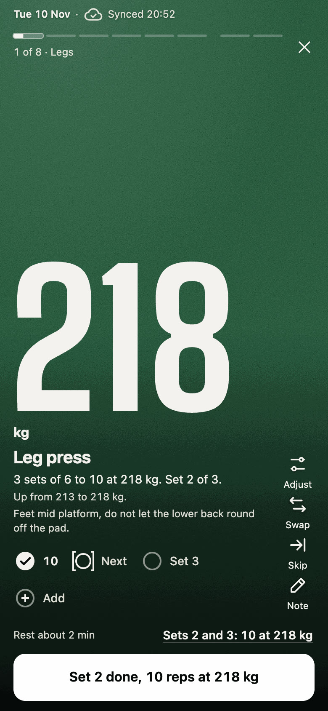
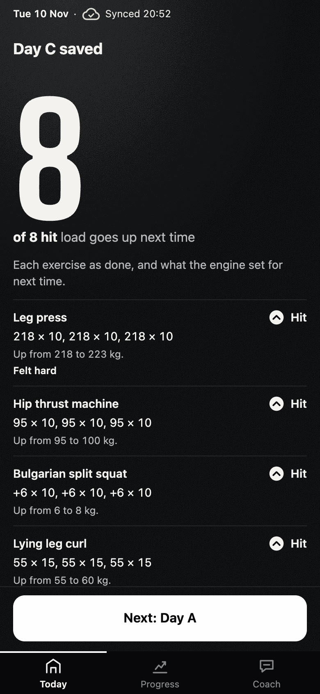

# Lasse

I build products that help people make decisions.

## Sextant

**Find the right roles early. Put your time into landing them.**

Keeping up with new vacancies means checking company sites, repeating searches, and reading roles that only look relevant from their titles. That effort competes with the work that makes a candidate stronger: preparing for interviews, building skills, and writing thoughtful applications.

Sextant takes on the daily discovery work. In its current live setup, it scans a pool of **6,000+ roles every day** and delivers relevant opportunities to the inbox. Matching draws on a configurable company priority list, career background, skills, and practical constraints to explain why a role deserves attention.

The companion app turns those recommendations into action: clear fit bands help prioritise the list, evidence highlights strengths and gaps to address in an application, and a tracker keeps the next steps organised.

**Live and in active testing.** The next ambition is an open-source setup that lets other candidates configure and run a search around their own goals.

**Inside Sextant:** an app screenshot captured on 8 September 2026, plus an email excerpt from 4 September. Counts and recommendations are snapshots of the displayed runs. The operational app remains owner-only because it contains personal job-search data.

*From the scanned catalog to a prioritised set of opportunities.*

See the email digest

*The inbox digest brings together scan results, source-health signals and an explanation of role fit. This excerpt omits the email headers and personal eligibility details.*

**Built with:** Python, Claude, Next.js, TypeScript, Supabase Postgres, GitHub Actions, Resend, and Vercel.

## Movie Match

**Bring the fun back to movie night.**

*One full game on the live beta with two demo players. The two AI waits are cut and the swipes are sped up. The 2.0 video with sound is further down.*

You sit down together to watch a film. Half an hour later, you're still switching apps, scrolling past recommendations, and asking, “What about this one?” Each service offers a different slice of the film catalog and a different idea of what you might like. Choosing becomes the evening.

Movie Match brings the search across streaming services into a playful game for two people sharing one phone. Recommendations start with **tonight's mood and the person beside you**. In a game designed to take under three minutes, you choose your moods, react to films, and pick from a shortlist of films you can stream tonight. You land on one you both picked, with where to watch it.

**Behind the scenes**

- **Your taste, mapped.** Over 15,000 films are stored as embeddings. Each player's likes become a taste fingerprint, and the search looks near both of you, including where your tastes meet.
- **Built for both of you.** AI plans the search from both players' moods and ranks both lists together, so a match isn't left to luck.
- **Only what you can stream.** Every film is checked in code against your services in your region. The AI never decides availability.
- **Tested before it ships.** Matching changes run against 17 frozen test couples and an independent AI judge, with the pass bars committed before each run. When a bar fails, the [results](https://github.com/lasse-max/movie-match/blob/main/eval/e4-results.md) say so.

**Now in beta, with 2.0 rolling out:** catalogue search went live on 7 November 2026. Focused user testing is generating strong early feedback as the product moves towards launch.

[Try the beta](https://movie-match-rho.vercel.app) · [See how it works](https://github.com/lasse-max/movie-match)

  
  
  

*Screens from a demo game on the live beta on 10 November 2026, with two made-up players. Titles and availability reflect that session.*

https://github.com/user-attachments/assets/be84b714-1a61-46d8-9c54-121669633c9f

*The 2.0 video, 61 s with sound: a full game with two demo players, and what happens behind the scenes.*

**Built with:** Next.js, React, TypeScript, Tailwind CSS, Claude, embeddings, Supabase Postgres with pgvector, TMDB, and Vercel.

## Training Coach

**Your next session, ready when you walk into the gym.**

Last week's notes say “leg press 10, 8, 8”. At the gym, you work out what to lift today, whether the weight should go up, and which day comes next, with one thumb between sets.

Training Coach works it out from what you logged. It opens on the next session in the rotation with every exercise, set, rep and load filled in. One tap logs a set as planned. After you save, it shows what each lift did and what changes next time. It keeps working with no signal.

https://github.com/user-attachments/assets/9245338c-6b13-4dbf-b567-e215e445b89c

*30 s with sound: a session with a made-up demo user, where Progress shows you're behind, and the AI coach planned next, shown as a labelled mock-up.*

**Behind the scenes**

- **Every session sets up the next.** The app works out every exercise, set, rep and load from what you logged. On the big lifts, 10 reps on every set means the load goes up next time. A test fails if the engine ever imports the AI or integration code, so today's plan never waits on either.
- **Works with no signal.** The app opens on the last plan it fetched, and a save waits on the phone until it can sync.
- **Made for one thumb.** One exercise fills the screen with the load as a big number, and the button that logs the set as planned sits under your thumb.
- **Reviewed before launch.** An independent AI reviewer, a different model from the one that writes the code, checked it seven times and found 19 blockers, among them an offline save that reported success while dropping the workout. The suite now has 730 tests.

**Live since 2 November 2026, for my own training.** Next on the roadmap: an AI coach that reviews each session and each week and suggests changes I accept or decline, then Whoop recovery, sleep and strain beside the training, and later runs from Strava. The app and its repo are private because they hold my training data. Walkthrough on request.

  
  
  

*Screens from a made-up demo user with four weeks of invented sessions, run locally. No real training data.*

**Built with:** Python, FastAPI, Supabase Postgres, a vanilla JavaScript PWA, and Vercel.

## How I work

I define the product requirements, shape the user experience, and test the results. I use AI assistants for implementation and review.

## Contact

[Email](mailto:lassekrgr@gmail.com)
